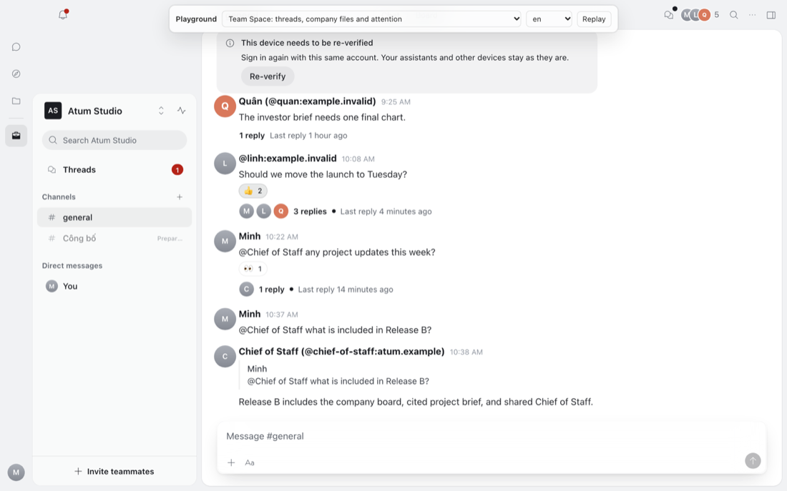
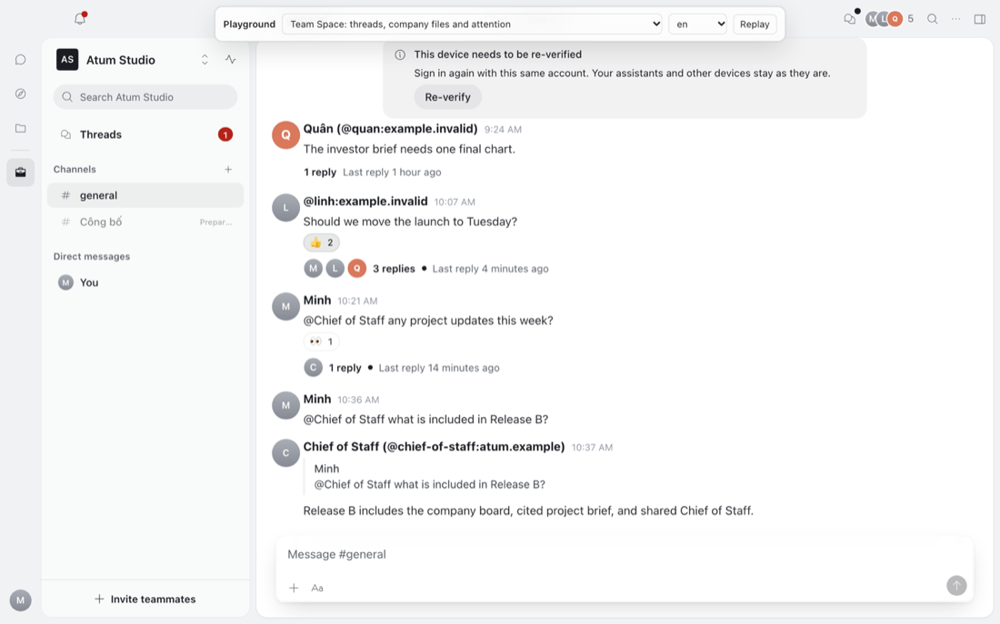
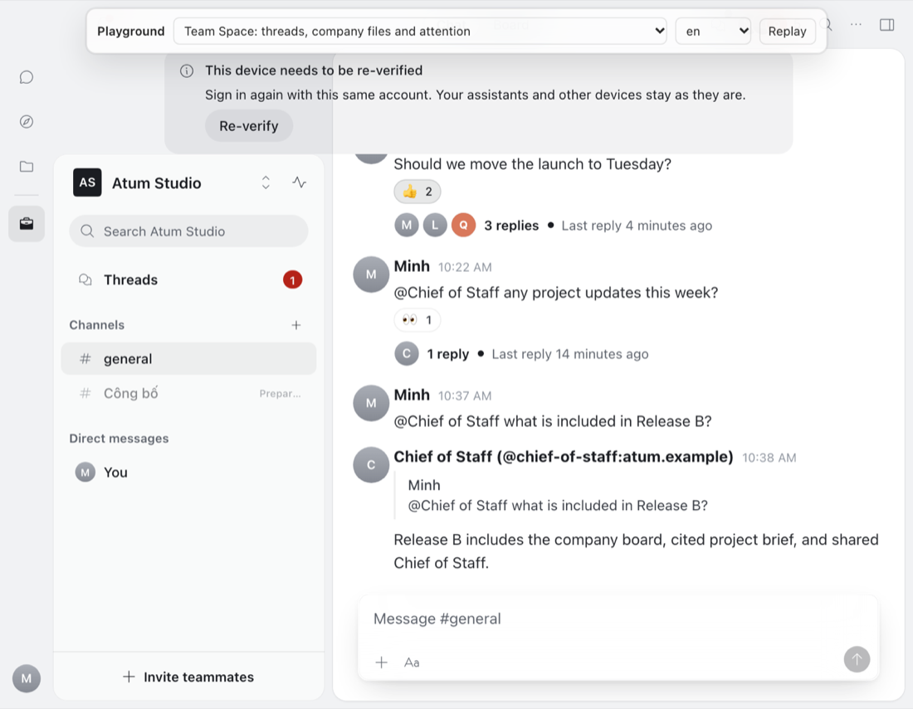
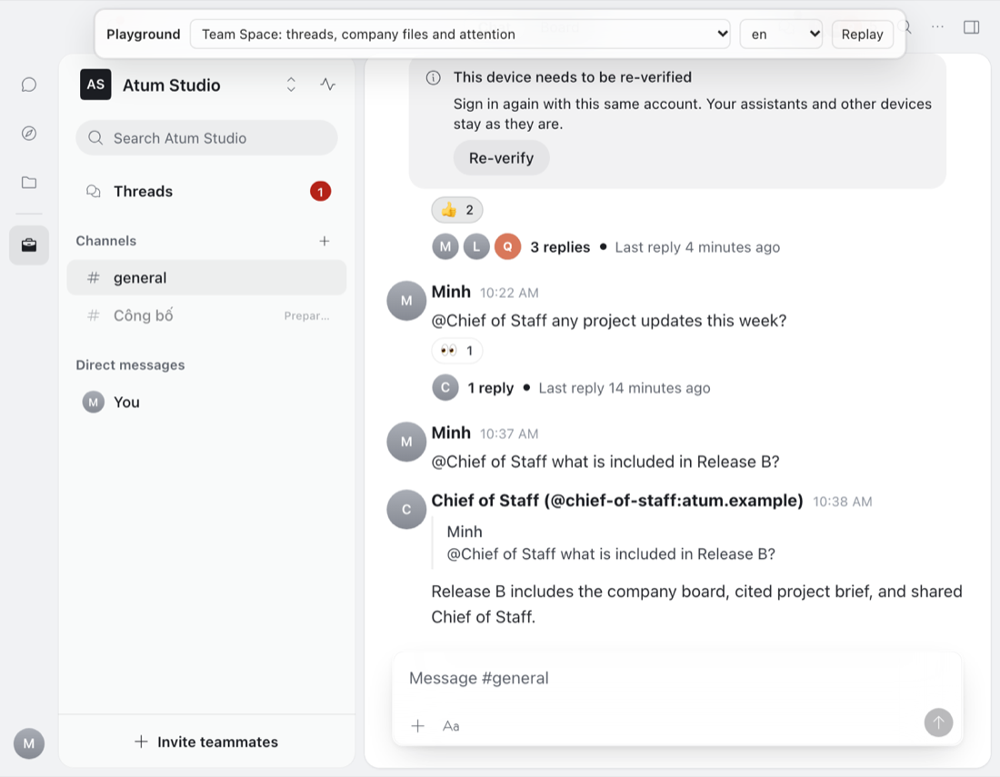
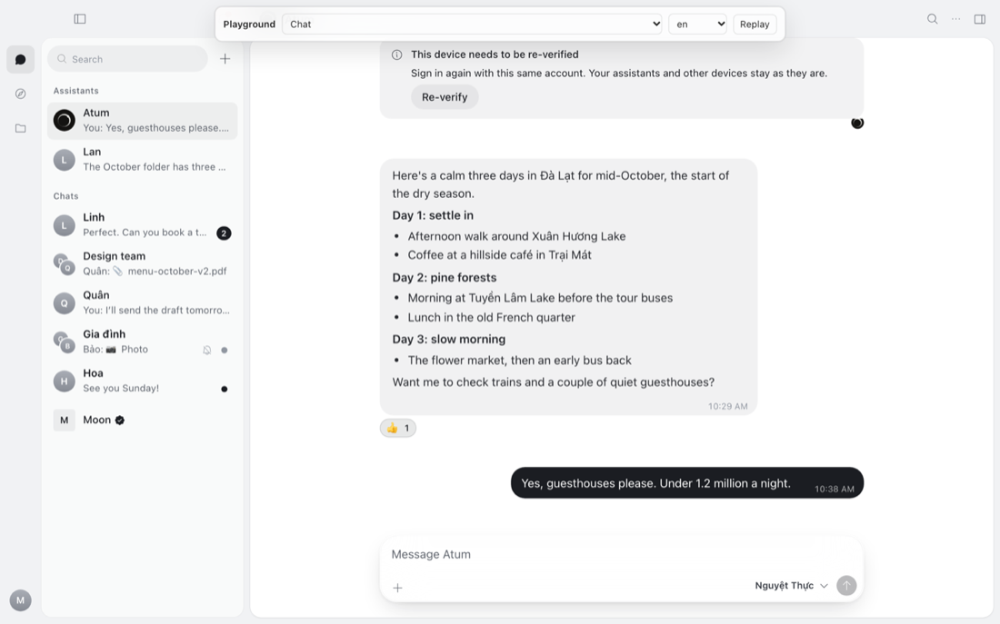

# Team Space: notices sit in the main column (2026-11-24)

**Bug (owner, 2026-11-24):** a window notice band (for example "This device needs to be re-verified",
`MatrixDeviceHealthNotice`) pushed the whole Team Space layout down, the company sidebar included.

**Cause:** `src/matrix/app.tsx` drew the notice stack (`data-matrix-status-stack`) at the top of the chat
section, above every view. Personal chat and Drive put their sidebars in the shell's navigation slot,
so there the band only offset the main column. Team Space draws its own sidebar inside
`MatrixCompanyWorkspace`, so the band sat above the sidebar too (sidebar top 152px instead of 48px).

**Fix:** the stack is built once (`statusStack` in app.tsx). Outside Team Space it renders where it did.
In Team Space it goes through `MatrixWorkspace` as `notices` into `MatrixCompanyWorkspace`, which renders
it at the top of its main column (`data-matrix-company-content`), above the Chat/Board tab panels.
Settings-opened workplace pages (no sidebar) show it above the page as before. Work has no notice stack.
In a narrow window showing only the channel list, the content column is hidden, so the band shows once
a channel is open.

**Tests:** `company-workspace-v1-1.test.tsx` (notices render inside the main column, not the sidebar) and
`app.test.tsx` "shows window notices inside the Team space main column, never above its sidebar" (fails
on the old app.tsx, passes now).

| | Before | After |
|---|---|---|
| Wide |  |  |
| Narrow |  |  |

Personal chat, unchanged: 

Captured from the playground: `matrix-playground.html?scenario=team-space-threads&damaged=1`.
